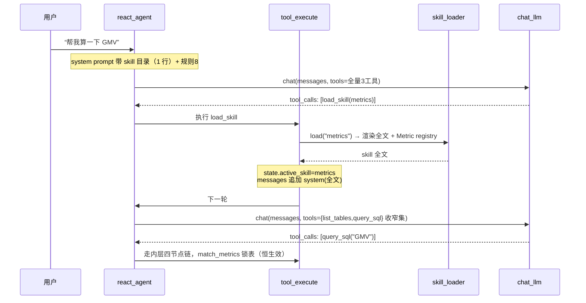

# M8：指标 Skill 最小实现设计

> 创建日期：2026-10-22 ｜ 状态：**已实施完成**（同日按第 9 节步骤全量落地，214 测试绿 + 真实 LLM e2e 通过） ｜ 背景：精读 Zafer-Liu/Data-Analysis-Agent 的 skill 系统后提炼

## 0. 一句话目标

把「指标口径」从代码常量（`data/metrics.py` 的 `STDW_METRICS`）搬进 skill 包（`skills/metrics/SKILL.md` + `references/`），并给外层 ReAct 增加 `load_skill` 工具，实现两个参考项目已验证的设计：

- **渐进式披露**：system prompt 只带一行 skill 目录，激活后才注入全文（省 token）
- **最小权限**：激活 skill 后，暴露给 LLM 的工具集按 `allowedTools` 收窄（只收窄、不扩权）

内层口径锁表防线**不依赖** skill 是否激活——`match_metrics` 是纯代码恒生效，硬约束一条不丢。

## 1. 现状盘点（为什么要做）

| 位置 | 现状 | 痛点 |
|---|---|---|
| 口径数据源 | `data/metrics.py` 硬编码 `STDW_METRICS` 常量 | 改口径要动代码；新增指标必须发版 |
| 外层注入 | `react.py initial_messages` 每次请求全量注入「可用指标清单」 | 无论问不问指标都背着；口径多了 prompt 膨胀 |
| 工具暴露 | `TOOL_SCHEMAS` 三工具对每轮对话全量开放 | 无按场景收窄；LLM 可能被诱导调无关工具 |
| 知识类型 | 只有「指标」一类知识安在 metrics.py | 分析模板、报告规范等新知识类型无处安放 |

## 2. 借鉴参考项目的 4 个设计（按性价比排序）

| # | 设计 | 参考项目出处 | 我们怎么抄 |
|---|---|---|---|
| 1 | 工具白名单收窄 `filter_exposed_tools`：交集收窄、只收窄不扩权 | `agent/skills/executor.py` L22-26 | 纯函数移植，语义照抄 |
| 2 | 渐进式披露：目录常驻、全文按需注入 | SKILL.md frontmatter 机制 | 目录一行一个 skill；`load_skill` 后才注入全文 |
| 3 | 口径内容放 `references/` 文件：配置即数据 | SKILL.md + references 资源 | `references/metrics.md` 结构化定义 5 个指标 |
| 4 | 显式 `load_skill(name)` 触发 | 其 `[ACTIVE ANALYSIS SKILL: name]` 激活 | 用工具调用替代隐式匹配，最小实现不建检索 |

**M8 明确不做**（参考项目有、我们暂缓）：向量三通道检索 + RRF、热重载、builtin/user/workspace 三级目录覆盖、`$ARGUMENTS` 参数渲染、trusted_skill_name 敏感工具解锁、前端 skill 管理页。

不做检索的理由：个人项目初期 skill 就 1~2 个，目录在 prompt 里就一行，LLM 看到目录必然能选对；等 skill 数量超过 prompt 舒适区（>10 个）再上 M9 检索。

## 3. 目标文件布局

```
data-agent/
├── skills/                        # 新增：skill 包根目录
│   └── metrics/
│       ├── SKILL.md               # 入口：frontmatter + 简短指引
│       └── references/
│           └── metrics.md         # 5 个指标口径（结构化，加载器要解析）
├── agent/
│   ├── skill_loader.py            # 新增：解析/渲染/收窄（纯代码，无 LLM）
│   ├── tools.py                   # 改：TOOL_SCHEMAS + load_skill；registry 增闭包
│   ├── react.py                   # 改：目录注入 / 收窄传参 / active_skill 状态
│   ├── llm.py                     # 改：ReActChatModel 签名加 tools 参数
│   └── graph.py                   # 改：metric_registry 改为显式传入
├── api/server.py                  # 改：SkillLoader 单例 + 参数透传
└── data/metrics.py                # 改：删 STDW_METRICS 常量，只留类型与匹配逻辑
```

## 4. 文件格式定义

### 4.1 `skills/metrics/SKILL.md`

```markdown
---
name: metrics
description: 电商指标口径查询技能（GMV/订单量/支付转化率/客单价），涉及指标计算时先加载本技能
allowedTools: [list_tables, query_sql]
---

# 指标口径查询

用户问题涉及下方口径清单中的任一指标时，按以下规则执行：
1. 子问题只写指标名（如"查询 GMV"），不要自行指定表名
2. 责任表由口径定义唯一决定，禁止换成其它表
3. 查询前先 call list_tables 确认责任表已加载

详见 references/metrics.md
```

约束（对齐参考项目 parser 思路的简化版）：
- `name` 必填，匹配 `^[a-z][a-z0-9-]{0,63}$`
- `description` 必填且 ≤ 120 字符（目录里展示，太长吞 prompt）
- `allowedTools` 可空 = 不限制工具；填写则按交集收窄
- frontmatter 缺失或非法 → 加载器报错，该 skill 不出现在目录中（fail-closed）

### 4.2 `skills/metrics/references/metrics.md`

```
## gmv
- 别名: 销售额 / 成交额 / 交易额 / gmv
- 责任表: ods_order_info
- 口径 SQL: SELECT SUM(amount) AS gmv FROM ods_order_info
- 说明: GMV 统计口径：按下单金额计入（含未支付订单）。

## order_cnt
...（其余 4 个指标同构：字段=当前 STDW_METRICS 原值）
```

关键：要用**固定字段行**而不是自由 markdown，因为加载器要把每段解析成 `Metric` dataclass（复用 `data/metrics.py` 现有结构）。5 个指标内容直接平移现有 `STDW_METRICS`，数值零改动。

## 5. 运行时机制



三个关键时序点：

1. **目录注入**（`initial_messages`）：把 `format_metric_catalog` 的全量清单替换成一行目录 + 新规则 8：
   「系统下方若有可用技能，涉及对应领域问题（如指标口径类）先调 load_skill 加载技能，再拆解子问题。」
2. **激活**（`tool_execute`）：`load_skill` 执行成功后，立刻在消息列表末尾追加一条 system 消息（渲染后的 skill 全文）——零额外 LLM 调用，下一轮决策自然看到全文。
3. **收窄**（`react_agent`）：每轮调用 `chat_llm` 前计算 `filter_exposed_tools(TOOL_SCHEMAS, active_skill)`，把收窄后的 schemas 作为参数传入。

## 6. 关键设计决策（含为什么）

| # | 决策 | 为什么 |
|---|---|---|
| D1 | **口径搬家、匹配留代码**：`match_metrics` 的 registry 来自 loader 渲染，但匹配逻辑恒运行，不依赖 skill 激活 | 保住硬约束「指标口径锁定指定责任表」——未加载 skill 时内层照样锁表，最多外层子问题不够精准 |
| D2 | **触发靠 LLM 显式调 load_skill**，不建自动匹配/检索 | 符合项目约定「LLM 只用于临场决策」；解析、渲染、收窄全部纯代码 |
| D3 | **收窄语义**：`allowedTools` 空 = 不限制（全量）；填写 = `全集 ∩ allowedTools`，结果绝不会比全集大 | 照抄参考项目「只收窄不扩权」——skill 永远无法解锁新工具 |
| D4 | **chat_llm 签名扩展**：`ReActChatModel = Callable[[list[dict], list[dict] | None], dict]`，`tools=None` 时用构建时的默认全集 | 收窄的物理落点；生产/测试 fake 同步改签名，server.py 构建处不变 |
| D5 | **active_skill 进 state**，两个节点都必须显式携带 | LangGraph 1.x dict state 全量替换的坑（项目已实测踩过：漏带 = 键消失，收窄立刻失效） |
| D6 | **注入用消息追加而非改 system prompt** | 不会打断已进行的对话；且 prompt 结构保持「目录常驻、全文临时」的分层 |

## 7. 代码改动点清单

| 文件 | 改动类型 | 要点 |
|---|---|---|
| `agent/skill_loader.py` | 新增（≤500 行） | `Skill` dataclass；`parse_skill_dir()` 解析 frontmatter + references → `Metric` 列表；`render_skill_prompt(name)` 渲染全文；`list_skill_catalog()` 产目录文本；`filter_exposed_tools(schemas, allowed)` 纯函数；全部无 LLM 依赖 |
| `data/metrics.py` | 修改 | 删 `STDW_METRICS` 常量；`Metric` dataclass 与 `match_metrics` / `format_metrics_prompt` 保留；`format_metric_catalog` 删除（职责被目录取代）；registry 无值时返回空列表 |
| `agent/graph.py` | 修改 | `build_graph(service, llm, metric_registry=None)`、`run_analysis` 同加参；`collect_schema` 里 `match_metrics(question, tables, metric_registry)` 显式传 |
| `agent/tools.py` | 修改 | `TOOL_SCHEMAS` 追加 `load_skill`（name 必填）；`build_tool_registry` 增 `load_skill` 闭包（返回激活 skill 名或错误文本）；`execute_tool_call` 返回值扩展 `skill` 字段；`query_sql` 透传 metric_registry |
| `agent/react.py` | 修改 | `initial_messages` 注入目录 + 规则 8（删全量清单）；`react_agent` 里 `chat_llm(messages, filtered_schemas)`；`tool_execute` 写 `active_skill` + 追加 system(全文)；两个节点都携带 `active_skill`（D5） |
| `agent/llm.py` | 修改 | 类型别名扩展（D4）；`build_deepseek_chat_generator` 内 `tools=` 用入参或默认全集 |
| `api/server.py` | 修改 | 模块级 `skill_loader = SkillLoader(PROJECT_ROOT / "skills")`；构建 registry 传给 `build_react_graph` / `run_react_analysis` / registry |

## 8. 测试方案

| 组 | 用例 | 断言 |
|---|---|---|
| skill_loader 单测 | frontmatter 缺 name / 非法名 / 缺 description | 报错且该 skill 不进目录（fail-closed） |
| | references 解析成 Metric | 字段与原 STDW_METRICS 逐項相等 |
| | `filter_exposed_tools` 交集 / 空 allowedTools / 未激活 | 收窄正确；空=全量；未激活=全量；任何结果 ⊆ 全集（不扩权） |
| react 集成（fake chat） | 脚本：第1轮 load_skill(metrics) → 第2轮 query_sql | 第2轮 fake 收到的 tools 只有收窄集；messages 含 system 全文；`active_skill` 跨节点存活（D5 回归） |
| | load_skill 未知名 | 错误文本回喂、`active_skill` 不变、循环可继续 |
| graph 单测 | registry 传 None vs 传入 | None 时不注入口径段、不锁表报错；传入时锁表文案出现 |
| e2e（真实 LLM） | 「帮我算一下 GMV」 | SSE 事件流出现 `load_skill` + `query_sql` 两次 tool_call；答案来自 ods_order_info |

## 9. 实施步骤（每步可独立验证）

1. 写 `skills/metrics/SKILL.md` + `references/metrics.md`（纯文本，验证：内容与原口径一致）
2. 写 `agent/skill_loader.py` + `tests/test_skill_loader.py` → green
3. 改 `data/metrics.py`（删常量、API 参数化）+ 改 `graph.py` / `tools.py` 透传 → 现有 188 测试全绿（行为等价迁移）
4. 改 `agent/llm.py` 签名 + `react.py` 收窄传参，fake chat 同步 → 全绿
5. `tools.py` 加 `load_skill` 工具 + `react.py` 激活/状态/注入 → 集成测试 green
6. `api/server.py` 接 SkillLoader 单例 → e2e 一条真实链路通过
7. README：目录结构 + M8 行 + 测试数更新

## 10. 面试怎么讲（3 点价值 + 1 句总述）

**总述**：把指标口径从代码常量重构为 skill 包，引入渐进式披露和工具集最小权限，参考开源项目 skill 系统做的自研简化版。

- **配置即数据**：改口径、加指标只动 `references/metrics.md` markdown 文件，不碰任何 Python 代码，不重新发版
- **渐进式披露**：system prompt 从「全量指标清单」降为「一行技能目录」，按需加载全文——口径越多越省 token
- **最小权限**：激活技能后 LLM 可见的工具集按 `allowedTools` 求交集收窄（只收窄不扩权），减少 LLM 被诱导调无关工具的概率；且内层锁表防线与激活状态解耦，安全不降级